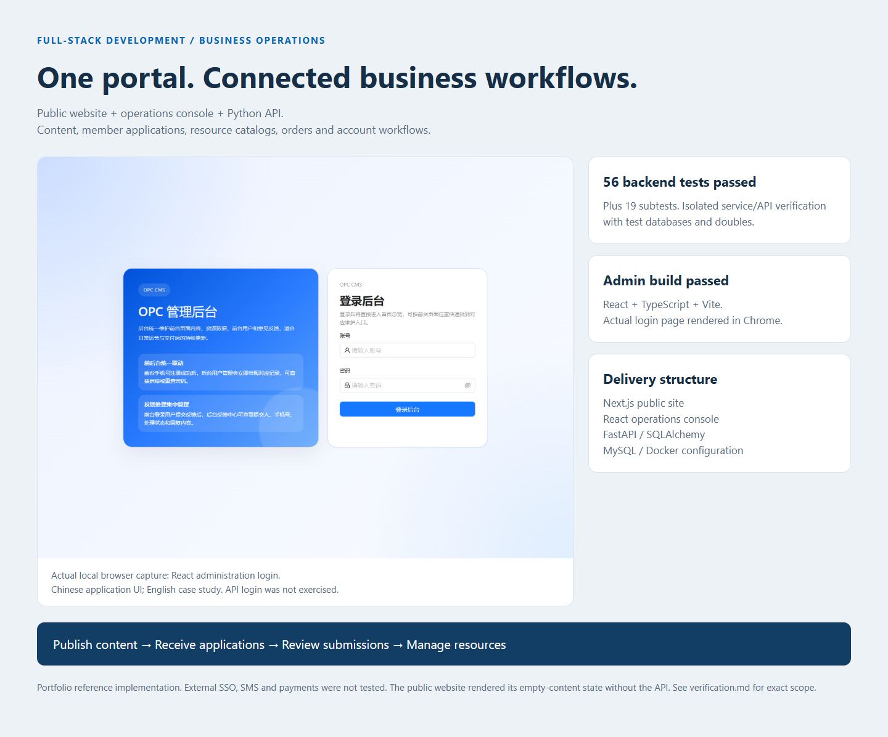

# Business Portal & Operations Dashboard

**A full-stack reference implementation for organizations that need a public website, member workflows and an operations console in one maintainable system.**

The project combines a Next.js public portal, a React administration application, a FastAPI backend and MySQL. Its value is the connected business workflow: publish content, receive applications, review submissions, manage resource products, track orders and reconcile account balances.

## What a client can evaluate

| Business workflow | Included implementation |
| --- | --- |
| Publish and maintain a portal | CMS-driven navigation, banners, news, services and resource listings |
| Handle member applications | Drafts, uploads, validation, review records and status tracking |
| Operate a product/resource catalog | Product and order services, payment notifications and reconciliation |
| Track prepaid usage | Balance, consumption imports, ledger and wallet services |
| Hand over the system | Separate web/admin/API applications, SQL upgrades, Docker configuration and backend tests |

## Verified product-management demo — 14 October 2026


The existing React admin was connected to the repository's original FastAPI authentication and product-management routes/services using an **isolated SQLite demo database**. Through the browser, we logged in, viewed three seeded sample products, created a fourth product, reloaded the page and confirmed that all four persisted. The data is explicitly fictional: these are functional records, **not customers, transactions or revenue**.

Backend verification on the same checkout: **56 tests and 19 subtests passed** (dependency/deprecation warnings remain). See [verification data](docs/portfolio/product-verification.json).

To reproduce this bounded module demo:

```powershell
# Terminal 1, after installing server requirements:
python docs/portfolio/demo_api.py
# Terminal 2:
cd admin
$env:VITE_API_BASE_URL="http://127.0.0.1:8211/api"
npm run dev -- --host 127.0.0.1 --port 3211
```

Local demo credentials: `portfolio` / `PortfolioDemo2026`. Open `http://127.0.0.1:3211`, then **交易管理 → 商品管理**. The demo binds to loopback only. Other menu modules are outside this small demo; full MySQL deployment, payments, SMS and SSO were not exercised in this run.

## Screenshots



The case study above includes a fresh local admin-page capture and the checks executed for this presentation. The following images are existing repository reference screenshots.


The screenshots show the reference application's Chinese UI. This README and the portfolio case study are in English; the application has not been represented as fully English-localized. The public repository uses demonstration data and disabled external adapters.

## Architecture and stack

```text
Public user -> Next.js website -> FastAPI public API -> MySQL
Operations -> React admin     -> FastAPI admin API  -> MySQL
                                    |
                          Optional integration adapters
```

- Public website: Next.js, React, TypeScript and Tailwind CSS.
- Admin application: React, Vite, TypeScript and Ant Design.
- Backend: Python, FastAPI, SQLAlchemy and Pydantic.
- Storage/deployment: MySQL, SQL migration scripts, Docker Compose and Nginx.
- Verification: service/API tests with isolated databases and test doubles.

## Local setup

Requirements: Docker Engine with Compose v2. From the repository root on Windows:

```powershell
Copy-Item .env.example .env
# Set your own local database passwords and signing secrets in .env.
docker compose --env-file .env -f deploy/docker/docker-compose.yml up -d --build
```

Endpoints: public site `http://localhost/`, administration `http://127.0.0.1:8081/`, health check `http://localhost/health`.

For application development, start MySQL, install `server/requirements.txt`, and run the API with `uvicorn app.main:app` from `server/`. Install each front end with `npm ci`, then use its `npm run dev` command. See the Compose and environment files for port and API-base settings.

## Verification commands

```powershell
cd server
python -m pip install -r requirements.txt pytest
python -m pytest tests -q
cd ../web
npm ci
npm run build
cd ../admin
npm ci
npm run build
```

See [portfolio verification notes](docs/portfolio/verification.md) for what was actually run for this presentation. Test results do not replace a deployed-system acceptance test.

## Project boundaries

The payment adapter is a **mock provider for demonstration**; real payment processing is not presented as live. SSO, SMS and trusted-data-space adapters need separately configured credentials, provider access and testing. Keep the admin interface private in production, disable test authentication shortcuts, and never commit deployment secrets or real member data.

This repository demonstrates implementation and delivery structure, not a claim of customer count, revenue, certified security or production uptime. A new engagement should agree on roles, application stages, integrations, hosting and acceptance criteria before estimating the build.

## Repository layout

`web/` public application · `admin/` operations application · `server/` API and tests · `deploy/` deployment and SQL · `docs/screenshots/` project images.

## Reuse

Published for portfolio review. No open-source license is granted by default; ask the repository owner before copying, redistributing or using the code commercially.

[Previous implementation notes](docs/legacy-readme.md)
