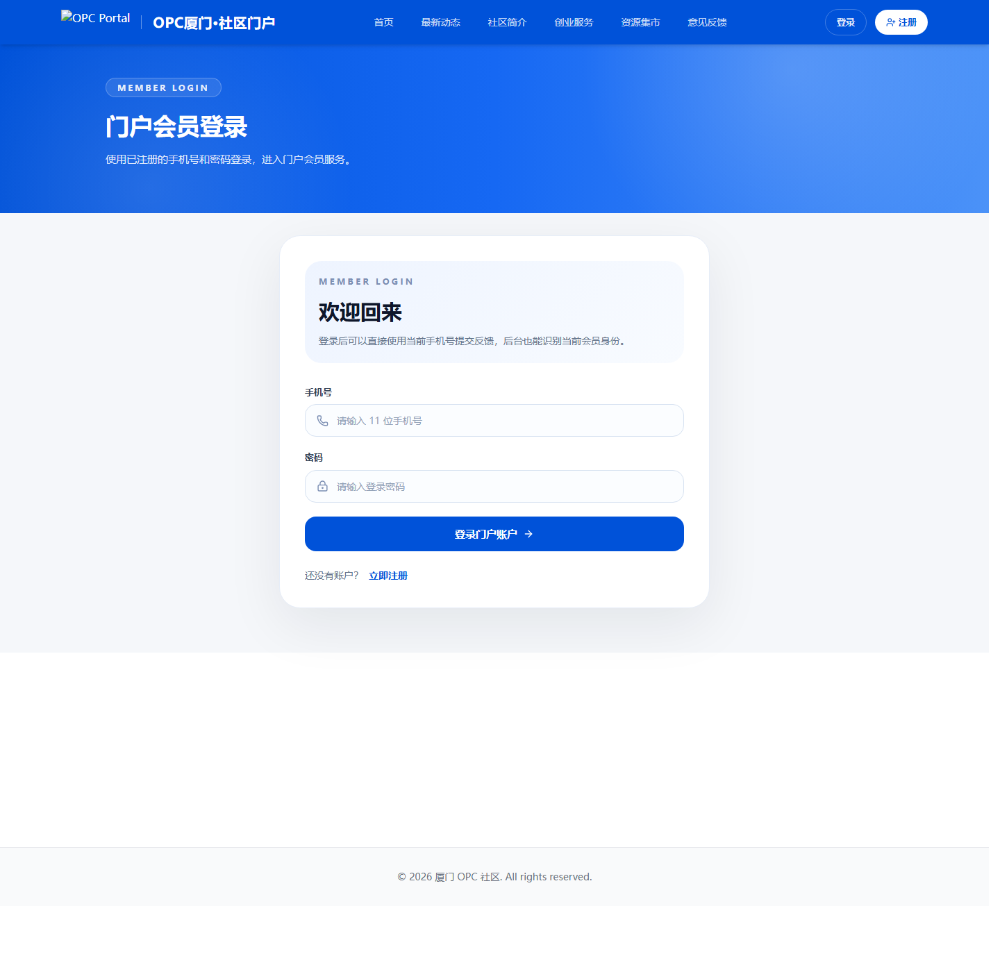

# OPC — business portal and admin dashboard

[中文说明](README.zh-CN.md)

This project brings a public website, member workflows and an admin console into one codebase. The public side uses Next.js, the admin uses React and Ant Design, and both connect to a Python/FastAPI backend.

The code covers content publishing, member applications, review records, a product catalog, orders and account ledgers. It is a useful starting point for discussing a business system because the pages, API and data model can be inspected together.

## An actual admin workflow


This is the running React admin, connected to the project's authentication and product-management routes. On 14 October 2026, I checked the following flow in the browser:

1. Sign in to the local demo.
2. Open the three seeded products.
3. Create another product using the form.
4. Reload and confirm that all four products remain.

The demo uses an isolated SQLite database and clearly marked **fictional products**. It checks the product-management flow; it does not represent customer transactions or a full production deployment.

The backend check on this checkout passed **56 tests and 19 subtests**. [Recorded results](docs/portfolio/product-verification.json).

## Other screens

These are existing project screenshots, separate from the local product-management run above.

**Public portal**


**Member sign-in**



**Admin sign-in**


The application UI is primarily Chinese. Writing the README in English does not mean the application has been translated.

## What's in the repository

| Area | Implementation |
| --- | --- |
| Website content | Navigation, banners, news, services and resource listings |
| Member applications | Drafts, file uploads, validation, review records and status tracking |
| Catalog and orders | Product services, orders, payment notifications and reconciliation code |
| Accounts | Balance, consumption imports, ledger and wallet services |
| Deployment | Separate web/admin/API apps, SQL upgrades, Docker and Nginx configuration |

The payment provider in this public version is a **mock adapter**. SMS, SSO and other external integrations require their own configuration and testing. They were not exercised in the local demo.

## Run the product-management demo

Install the backend and admin dependencies from the repository root:

```powershell
python -m venv .venv
.\.venv\Scripts\python.exe -m pip install -r server/requirements.txt
npm --prefix admin ci
```

Start the API in one terminal:

```powershell
.\.venv\Scripts\python.exe docs/portfolio/demo_api.py
```

Start the admin in another:

```powershell
cd admin
$env:VITE_API_BASE_URL="http://127.0.0.1:8211/api"
npm run dev -- --host 127.0.0.1 --port 3211
```

Open `http://127.0.0.1:3211`, sign in with the local demo account `portfolio` / `PortfolioDemo2026`, and choose **交易管理 → 商品管理**.

The helper binds to localhost and persists demo data in `docs/portfolio/demo.sqlite3`. It only wires up the auth and product routes needed for this example; other menu items are outside the demo.

## Full application setup

The normal backend uses MySQL. For the Docker setup, first review and fill in the environment values:

```powershell
Copy-Item .env.example .env
docker compose --env-file .env -f deploy/docker/docker-compose.yml up -d --build
```

Use your own database passwords and signing secrets. The configured endpoints are the public website at `http://localhost/`, admin at `http://127.0.0.1:8081/` and health check at `http://localhost/health`.

The Docker/MySQL deployment was not part of the SQLite demo. See [verification notes](docs/portfolio/verification.md) for earlier checks and their limits.

## Stack and code map

- `web/`: Next.js, React, TypeScript and Tailwind CSS.
- `admin/`: React, Vite, TypeScript and Ant Design.
- `server/`: FastAPI, SQLAlchemy, Pydantic and backend tests.
- `deploy/`: SQL, Docker Compose and Nginx.
- `docs/portfolio/`: Local demo helper, screenshots and verification notes.

Backend checks:

```powershell
cd server
python -m pip install -r requirements.txt pytest
python -m pytest tests -q
```

Frontend builds run with `npm ci` and `npm run build` in each frontend directory. Existing dependency/deprecation and admin bundle warnings are documented in the verification notes.

For a new system, I would start by mapping the user roles, the forms they fill in and who reviews each step. That makes the first deliverable easier to define than estimating every module at once.

## Reuse

Published for portfolio review. No open-source license is granted by default; ask the repository owner before copying, redistributing or using the code commercially.

[Earlier implementation notes](docs/legacy-readme.md)
