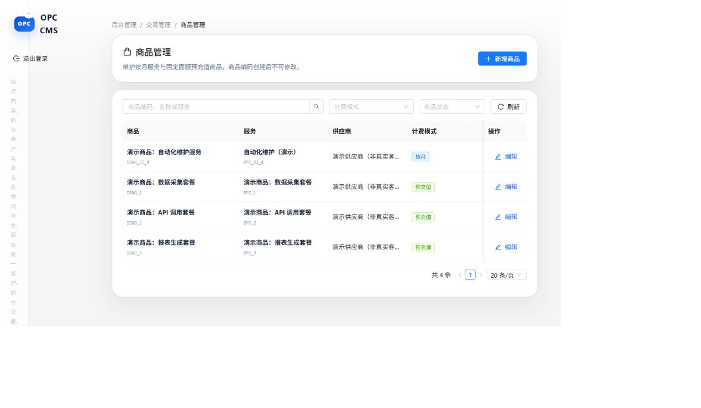
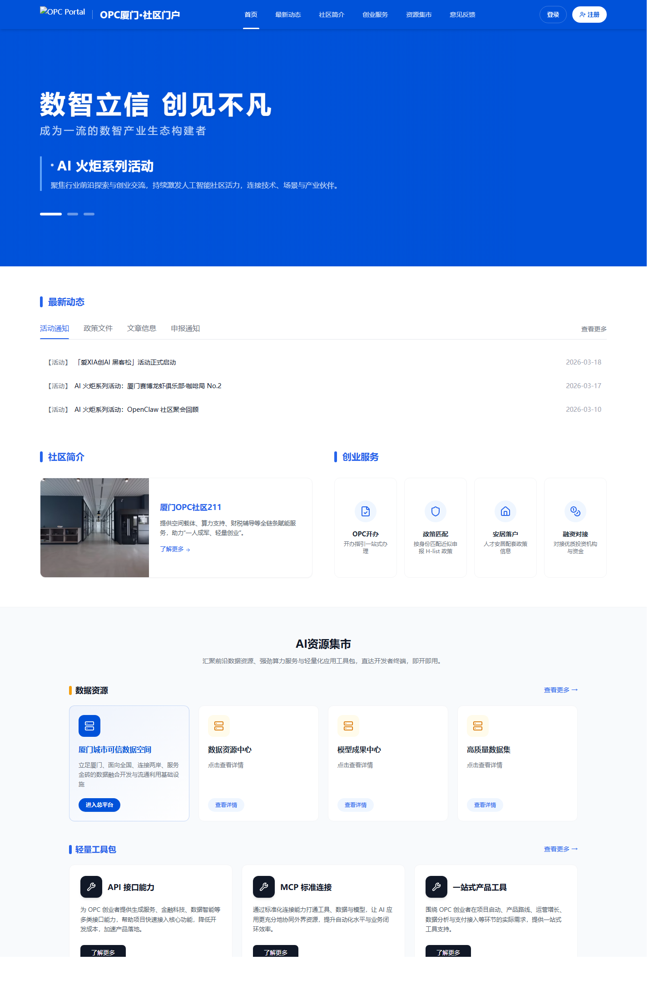
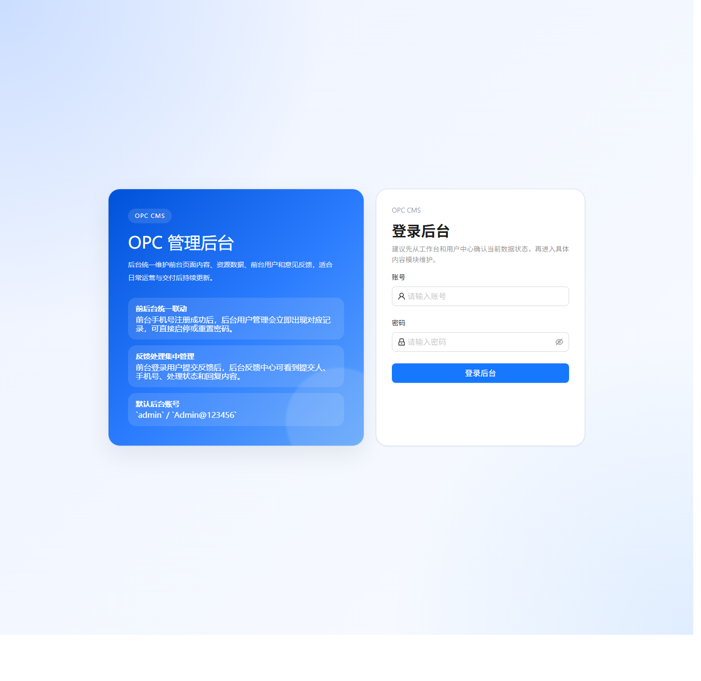

# OPC 业务门户与管理后台

[English](README.md)

这个项目把对外门户、会员申请和内部管理放在同一套系统里。门户用 Next.js，后台用 React + Ant Design，接口用 Python / FastAPI，常规部署使用 MySQL。

代码里有内容发布、资料提交、审核记录、商品管理、订单和账户流水这些模块。前后端、数据模型、部署文件都在仓库里，可以顺着一个业务功能看完整实现。

## 实际运行的后台

这张图来自实际运行的 React 后台。2026 年 10 月 14 日，把原来的登录、商品接口接到隔离的 SQLite 演示库后，走了一遍：

**登录 → 查看 3 个演示商品 → 在页面新增 1 个 → 刷新后仍能看到 4 个。**

商品是明确标注的演示数据。这里验证的是页面表单、接口和保存结果，不是客户订单或营收。同期后端检查通过了 56 个测试和 19 个子测试，[结果在这里](docs/portfolio/product-verification.json)。

## 门户页面

下面是仓库原有的项目截图，与上面这次本地运行截图分开说明。

## 项目里有哪些部分

- **门户内容：** 导航、轮播、资讯、服务和资源展示。
- **会员申请：** 草稿、附件、字段校验、审核记录和状态流转。
- **商品与订单：** 商品维护、订单服务、支付通知和对账相关代码。
- **账户：** 余额、消费导入、流水和钱包相关服务。
- **部署：** 前台、管理端、接口分别构建，配有 SQL 升级和 Docker / Nginx 配置。

公开版本的支付是模拟适配器。短信、SSO 等需要另配账号和联调，不包含在这次商品管理演示里。

## 本地试跑

[英文 README](README.md#run-the-product-management-demo) 写了完整启动命令。演示脚本是 `docs/portfolio/demo_api.py`，只绑定本机地址；启动 React 管理端后，可以登录查看商品、添加记录，再刷新检查保存结果。

正常系统部署使用 MySQL；这次为了单独展示商品流程，使用的是 SQLite 演示库，两者没有混写成一次全量上线验收。

如果要做类似后台，我会先把角色、表单和审核步骤梳理出来，再按模块拆交付。这样第一版做什么、怎么验收会更清楚。
