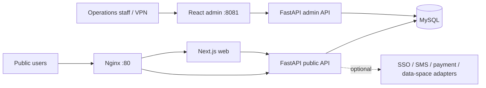

> Historical notes retained for reference. See the English root README and current source for supported paths and verified claims.

# Business Portal & Operations CMS

A production-oriented full-stack portal with a public Next.js website, a React administration console, a FastAPI service layer, MySQL persistence, and Docker-based deployment.

This repository is a portfolio-ready reference implementation of a real business platform. It demonstrates content operations, member workflows, application reviews, a resource marketplace, prepaid billing, wallet accounting, payment reconciliation, and optional third-party integrations in one codebase.

> The public repository contains demonstration data and disabled integration adapters only. Deployment credentials, customer data, and private infrastructure settings are intentionally excluded.

## Screenshots

| Public portal | Member sign-in | Admin console |
| --- | --- | --- |
|  |  |  |

## What it demonstrates

- Responsive public portal with CMS-driven navigation, banners, news, service pages, and marketplace content
- Separate React/Ant Design operations console with role-protected routes
- Member registration, sign-in, session handling, and an optional SSO adapter
- Multi-step business applications with drafts, uploads, validation, review records, and status tracking
- Resource marketplace for data, models, APIs, MCP services, tools, and compute products
- Product catalog, order lifecycle, mock payment provider, notification handling, and reconciliation
- Prepaid balances, consumption imports, ledger entries, wallet recharges, and wallet payments
- Optional trusted-data-space registration adapter with encrypted sensitive fields
- MySQL bootstrap data plus ordered, idempotent SQL upgrade scripts
- Docker Compose deployment with the public site and admin console exposed separately

## Architecture



The public reverse proxy exposes the website and `/api/public/*`. The administration console uses a separate bind address and port so production deployments can restrict it to localhost, a private network, or a VPN.

## Technology

| Layer | Main technology |
| --- | --- |
| Public web | Next.js 15, React 19, TypeScript, Tailwind CSS |
| Admin console | React 18, Vite, TypeScript, Ant Design, Axios |
| API | Python, FastAPI, SQLAlchemy, Pydantic |
| Data | MySQL 8.4, SQL bootstrap and upgrade scripts |
| Delivery | Docker Compose, Nginx, health checks |
| Tests | Pytest, FastAPI TestClient, service-level test doubles |

## Repository layout

```text
.
├── web/                 # Public Next.js application
├── admin/               # Private operations console
├── server/              # FastAPI application and tests
├── deploy/
│   ├── docker/          # Local and production Compose definitions
│   ├── nginx/           # Public reverse-proxy configuration
│   └── sql/             # Bootstrap schema/data and upgrade scripts
└── docs/screenshots/    # Portfolio screenshots
```

## Quick start with Docker

Requirements: Docker Engine with Docker Compose v2.

1. Create the local environment file:

   ```bash
   cp .env.example .env
   ```

   On PowerShell:

   ```powershell
   Copy-Item .env.example .env
   ```

2. Replace `MYSQL_PASSWORD`, `MYSQL_ROOT_PASSWORD`, `JWT_SECRET_KEY`, and `MOCK_PAYMENT_SIGNING_SECRET` in `.env` with random values. Optional external integrations are disabled by default.

3. Build and start the stack:

   ```bash
   docker compose --env-file .env -f deploy/docker/docker-compose.yml up -d --build
   ```

4. Open the services:

   - Public portal: `http://localhost/`
   - Admin console: `http://127.0.0.1:8081/`
   - Health check: `http://localhost/health`

5. Stop the stack without deleting database data:

   ```bash
   docker compose --env-file .env -f deploy/docker/docker-compose.yml down
   ```

The SQL files in `deploy/sql` are mounted only for first-time database initialization. For an existing database, apply the dated scripts in filename order; do not recreate the data volume.

## Local development

Start MySQL from Docker, then run each application in its own terminal.

```bash
docker compose --env-file .env -f deploy/docker/docker-compose.local.yml up -d mysql
```

API:

```bash
cd server
python -m venv .venv
# Windows: .venv\Scripts\activate
# macOS/Linux: source .venv/bin/activate
pip install -r requirements.txt
uvicorn app.main:app --reload --host 0.0.0.0 --port 8000
```

Public web:

```bash
cd web
npm ci
npm run dev
```

Admin console:

```bash
cd admin
npm ci
npm run dev
```

## Verification

```bash
cd server
pip install pytest
python -m pytest tests
```

```bash
cd web
npm ci
npm run build
```

```bash
cd admin
npm ci
npm run build
```

## Security and deployment notes

- Never commit `.env`, backup environment files, certificates, access tokens, or production database exports.
- Replace every `change-me-*` value before starting a shared or internet-facing environment.
- Keep `TEST_AUTH_BRIDGE_ENABLED=false` outside isolated automated tests.
- Use the mock payment provider for local demonstration only; connect a verified provider before accepting real payments.
- Keep the admin console bound to `127.0.0.1` by default. Expose it only through a reviewed firewall, VPN, or private network.
- Leave SSO, SMS, and trusted-data-space adapters disabled until their server-side credentials and certificate chain are configured.
- Treat uploaded files and SQL backups as runtime data; they are ignored by Git.

## 中文说明

这是一个面向企业门户和运营后台的全栈案例项目，包含门户内容管理、会员体系、业务申请审核、资源市场、订单支付、预付费余额、钱包流水及第三方系统适配。公开版本只保留演示数据和关闭状态的集成接口，不包含真实密钥、客户数据或生产环境配置。

本仓库主要用于展示完整业务系统的工程能力，包括前后端分离、复杂业务建模、权限边界、可测试的服务层、数据库升级和容器化交付。

## License and reuse

No open-source license is granted by default. The code is published for portfolio review. Contact the repository owner before copying, redistributing, or using it commercially.
